# Rapport — TP1 : Modélisation XML et Interrogation XPath avec Maven en Java 

## Objectif

Modéliser un domaine réel en XML, définir sa structure par un schéma XSD,
valider le document en Java, puis l'interroger avec XPath.

## Structure du projet
 
```
universite-xml/
├── pom.xml
└── src
    ├── main
    │   ├── java/com/univ/universite
    │   │   ├── Main.java            # Programme principal
    │   │   ├── XmlValidator.java    # Validation XML/XSD
    │   │   └── XPathQueries.java    # Requêtes XPath
    │   └── resources
    │       ├── universite.xml           # Document XML valide
    │       ├── universite.xsd           # Schéma XSD
    │       └── universite-invalide.xml  # Document XML invalide
    └── test/java/com/univ/universite
        └── UniversiteTest.java      # Tests unitaires JUnit
```

## Étape 1 — Choix du domaine et modélisation XML

**Domaine choisi : la gestion d'une université.** Le document
`universite.xml` contient trois entités :

| Entité | Attributs | Éléments enfants |
|---|---|---|
| `enseignant` | `id` | nom, prenom, departement, grade |
| `cours-item` | `id`, `optionnel` | titre, departement, credits, semestre, enseignantRef |
| `etudiant` | `id`, `actif` | nom, prenom, email, filiere, dateInscription (jour, mois, annee), moyenne |

Données : 4 enseignants, 5 cours, 4 étudiants. Le lien cours → enseignant
est réalisé par `enseignantRef` (mécanisme ID/IDREF).

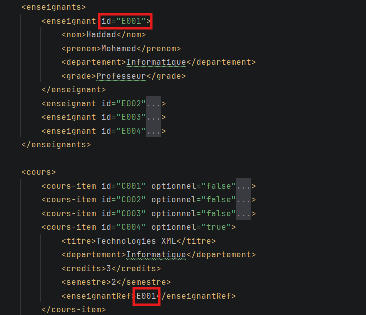

## Étape 2 — Création du schéma XSD

Le fichier `universite.xsd` décrit la structure attendue du document, avec des contraintes :
 
- moyenne comprise entre 0 et 20
- semestre compris entre 1 et 6
- `dateInscription` de type complexe `DateType` : jour (1–31), mois (1–12), annee (1900–2100)
- email respectant un motif (`xxx@xxx.xx`)
- grade limité à une liste : `Assistant`, `Maître de conférences`, `Professeur`
- identifiants au format `E001`, `C001`, `S001` (type `xs:ID`)
- `enseignantRef` de type `xs:IDREF` : il doit pointer vers un enseignant existant

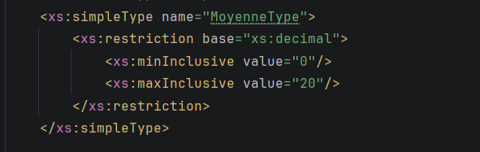

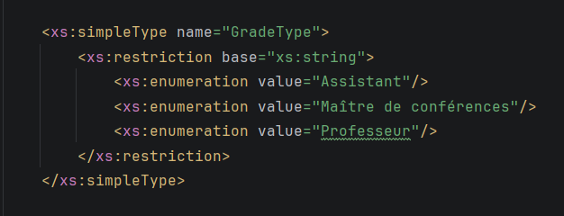

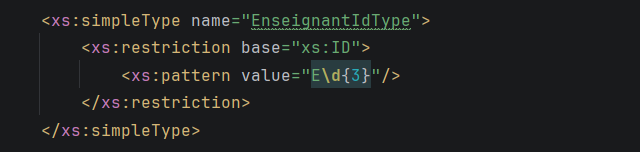

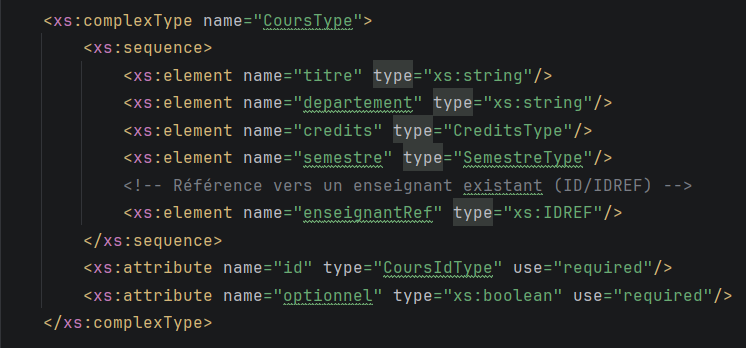

## Étape 3 — Création du projet Maven

Projet Maven créé dans IntelliJ IDEA (`groupId` : `com.univ`, `artifactId` : `universite-xml`, Java 17).
 
Dans le `pom.xml`, la validation XSD (`javax.xml.validation`) et XPath (`javax.xml.xpath`) font partie du JDK : **aucune dépendance externe n'est nécessaire** pour le programme. Seule dépendance ajoutée : **JUnit 5** (scope `test`) pour les tests unitaires.

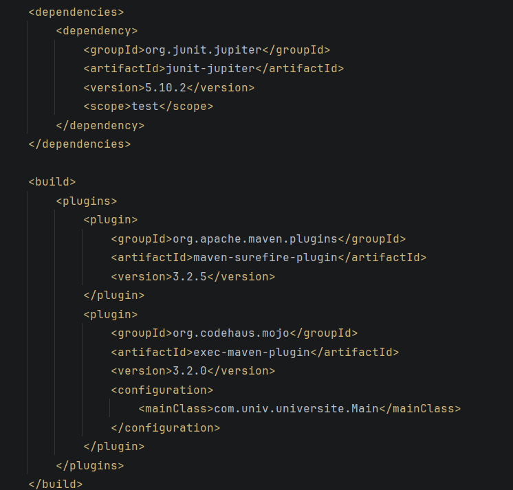

## Étape 4 — Validation XML/XSD

Classe `XmlValidator` :
 
1. `SchemaFactory.newInstance(XMLConstants.W3C_XML_SCHEMA_NS_URI)` crée la fabrique.
2. `factory.newSchema(...)` charge le fichier XSD.
3. `schema.newValidator()` crée le `Validator`.
4. `validator.validate(...)` valide le document XML.

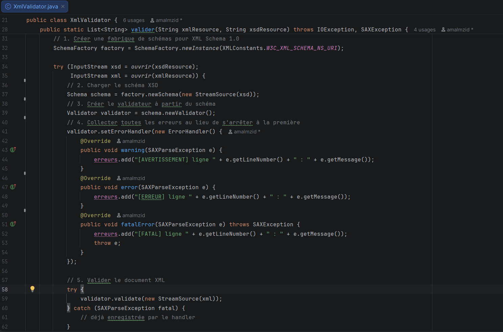

Un `ErrorHandler` collecte toutes les erreurs avec leur numéro de ligne. Le fichier `universite-invalide.xml` contient des erreurs volontaires (grade inconnu, booléen incorrect, email invalide, moyenne de 25, enseignant inexistant) pour démontrer le fonctionnement.

Résultat :

- `universite.xml` → **valide** (0 erreur)
- `universite-invalide.xml` → **rejeté** : 5 erreurs volontaires
  (grade hors énumération, IDREF `E999` inexistant, booléen `actif` invalide,
  email mal formé, moyenne 25 > 20)

## Étape 5 — Interrogation XPath

Classe `XPathQueries` : le document est chargé en DOM, puis `XPathFactory.newInstance().newXPath()` compile chaque requête en `XPathExpression`.

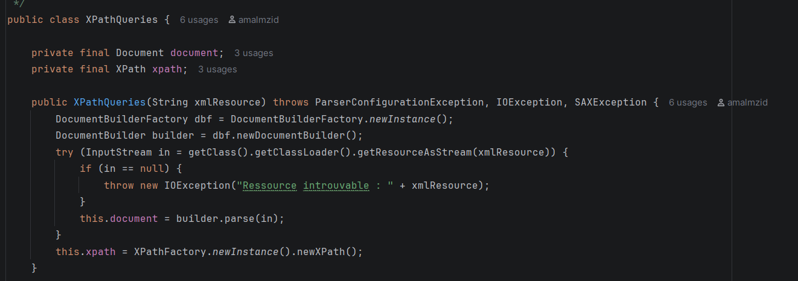

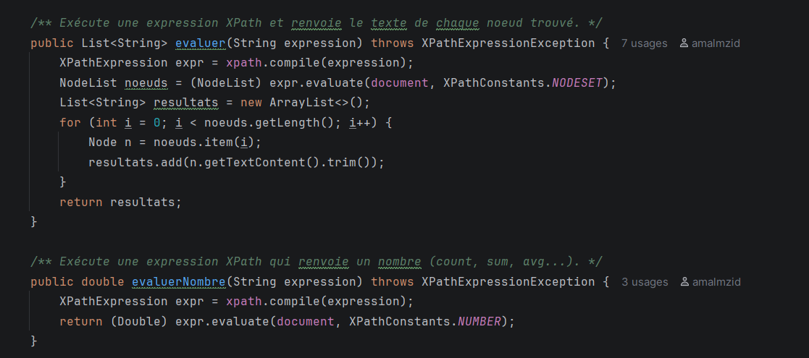

| Objectif | Expression XPath |
|---|---|
| Titres des cours | `/universite/cours/cours-item/titre` |
| Étudiants actifs | `//etudiant[@actif='true']/nom` + `/prenom` |
| Cours optionnels | `cours-item[@optionnel='true']/titre` |
| Cours d'Informatique | `cours-item[departement='Informatique']/titre` |
| Étudiants moyenne ≥ 14 | `etudiant[moyenne >= 14]/nom` |
| Cours de l'enseignant E001 | `cours-item[enseignantRef='E001']/titre` |
| Nombre d'étudiants | `count(//etudiant)` → 4 |
| Moyenne générale | `sum(...) div count(...)` → 13.81 |
| Total des crédits | `sum(//cours-item/credits)` → 21 |

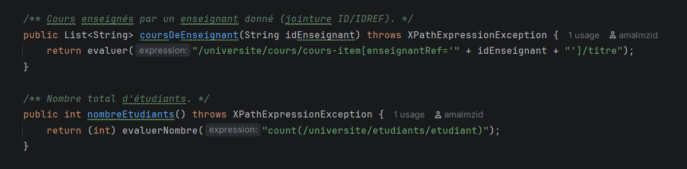

## Étape 6 — Test et vérification

Ouvrir le projet dans IntelliJ IDEA, laisser Maven importer, puis lancer `Main.java` à travers la commande `mvn compile exec:java` (ou `mvn test` pour les tests unitaires).

```bash
mvn compile exec:java   # validation + requêtes XPath
mvn test                # tests unitaires JUnit
```

## Exécution

Lancement du programme avec Maven :

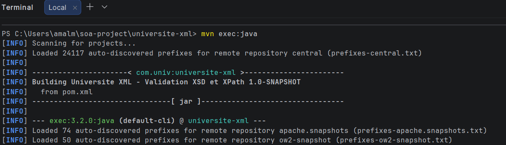

**Validation XML/XSD** : 

`universite.xml` est accepté (`OK`), mais
`universite-invalide.xml` est rejeté avec la liste des erreurs détectées
(énumération, booléen, pattern email, moyenne max, IDREF `E999` inexistant).

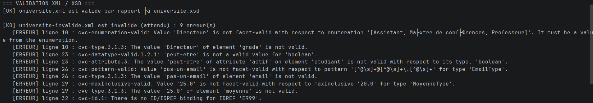

**Requêtes XPath** : 

le programme affiche les titres des cours, les étudiants
actifs, les cours optionnels, puis les autresrequêtes (cours d'Informatique,
moyenne ≥ 14, cours de l'enseignant E001) et les agrégats (4 étudiants,
moyenne générale 13,81, 21 crédits).

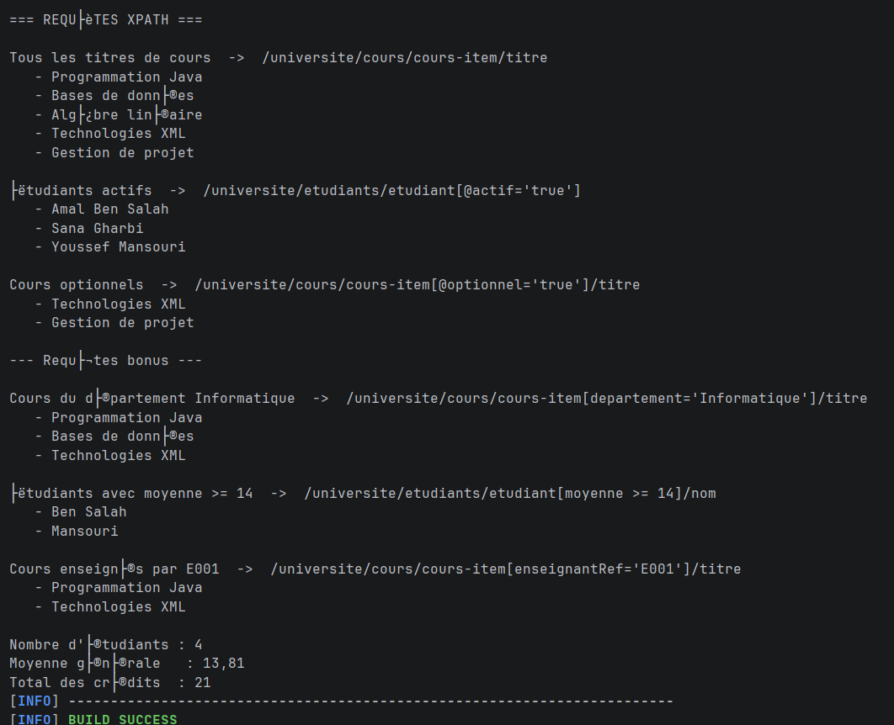


